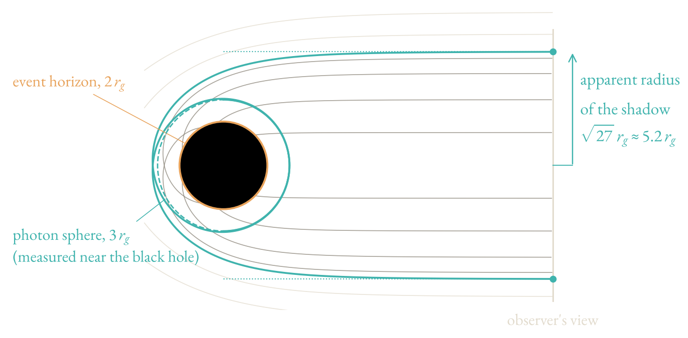
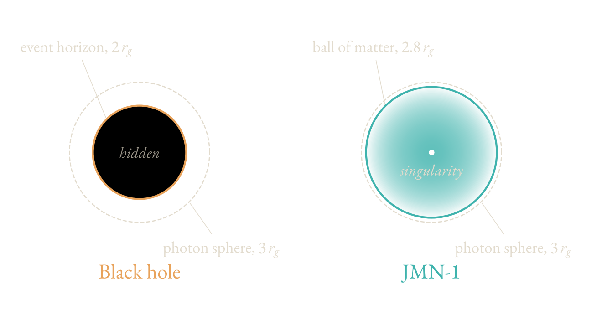
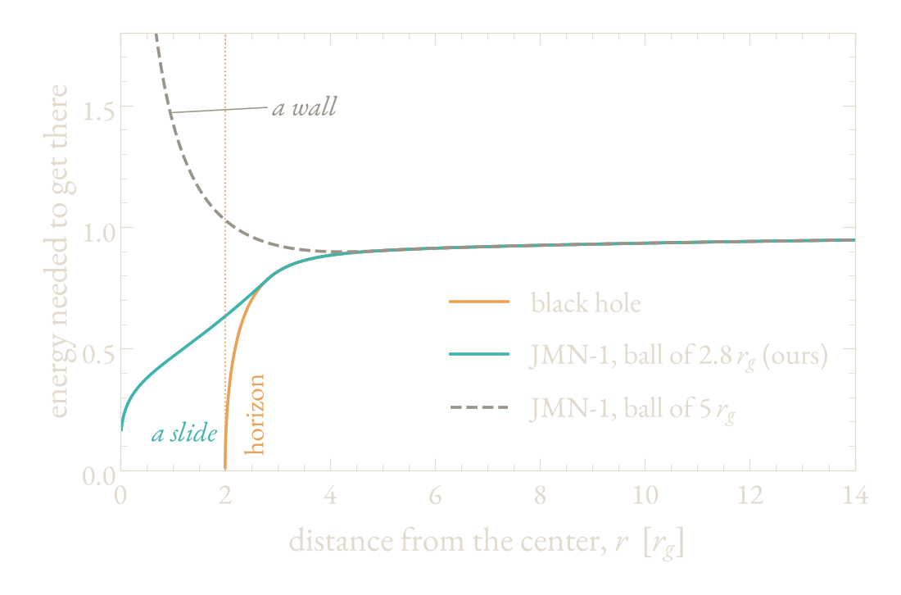
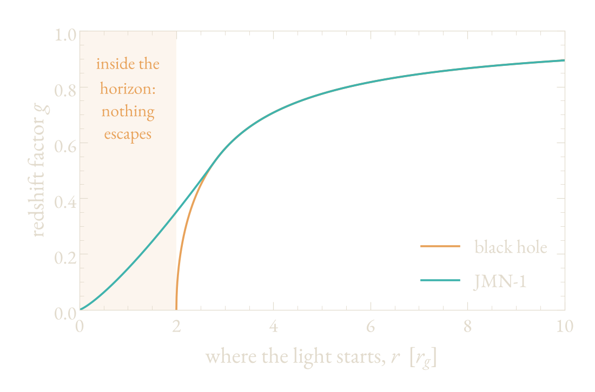

In 1937 a lost painting by Johannes Vermeer surfaced in the Netherlands. Vermeer is the seventeenth-century Dutch painter of *Girl with a Pearl Earring*. The leading Vermeer expert of the day called the painting a masterpiece, and a museum in Rotterdam paid a fortune for it.

It had been painted a few years earlier by Han van Meegeren, a Dutch artist the critics had ignored. He went on to sell several more "Vermeers", one of them to Hermann Göring, the Nazi leader. After the war, the Dutch police traced that sale to him and charged him with selling a national treasure to the enemy. His defense was a confession: he had painted it himself. When nobody believed him, he painted another one in front of witnesses.

The experts had checked everything they knew how to check: the colors, the faces, the cracks of old paint. The fake was finally exposed by chemistry. Van Meegeren had hardened his paint with an early plastic, a material that did not exist until the twentieth century.

I think about this story more often than an astrophysicist probably should. It asks the question every scientist has to live with: when everything you know how to check says "genuine", how sure are you?

In 2019 the Event Horizon Telescope (EHT), a network of radio dishes across the Earth working as a single telescope, published the first image of a black hole: a ring of light around a dark center, in the galaxy M87, 55 million light-years away. The object is called M87\*. We all called it a black hole, and it very probably is one. This explainer asks what an object that only looks like a black hole would have to be, and what would give it away.

## How a star becomes a black hole

Einstein's general relativity (1915) describes gravity as the bending of space and time by mass. A few weeks after it appeared, Karl Schwarzschild found the spacetime around a single non-spinning mass. Inside that solution sat a surface from which nothing can return: the [event horizon](#c-event-horizon){:.term}.



Whether nature could actually form one was unclear for decades. In 1939 Oppenheimer and Snyder answered it with the simplest collapse possible. B. Datt had found the same solution a year earlier. Their model:

- a ball of dust with no pressure and uniform density;
- released from rest.

The outcome:

- nothing resists the collapse;
- an event horizon forms before the center is crushed;
- the [singularity](#c-singularity){:.term}, the point of infinite density, forms behind the horizon, out of sight.



Almost every black hole in a textbook descends from this calculation. Its assumptions, though, are idealized: real stars have neither uniform density nor zero pressure.

## A different collapse

In 2011 Joshi, Malafarina and Narayan relaxed both assumptions:

- the density decreases outward from the center;
- the matter has pressure only in the sideways (tangential) direction. Picture particles on circular orbits around the center, pressing on their neighbors but never outward.

The outcome changes:

- the collapse slows and ends in a static ball;
- a singularity forms at the center;
- no event horizon forms. The singularity is naked.

This is the JMN-1 spacetime. Outside the ball it is identical to a black hole of the same mass, as Einstein's equations require. Inside it is a ball of matter with a singularity at its center.

No new physics is needed: the same theory with different initial conditions, and the horizon never appears. I find that the most unsettling part.

## Same shadow, different insides

What a telescope sees is set by light passing close to the object. At three gravitational radii from the center, measured near the black hole, light can orbit in a circle: the [photon sphere](#c-photon-sphere){:.term}. Light passing inside it falls in, and light passing outside escapes. A distant observer sees that circle enlarged by the curved space in between: its edge appears at $\sqrt{27} \approx 5.2$ gravitational radii, which makes the shadow of M87\* about 40 microarcseconds across on our sky, its [angular size](#c-angular-size){:.term}. Inside it the image is dark. That dark patch, the [shadow](#c-shadow){:.term}, is set by the photon sphere, not by the horizon.





<figure class="figure"><figcaption>Light leaves $P$ on the photon sphere, at $3\,r_g$, and bends on its way out. The observer traces it back along a straight line and places it at $P'$, $\sqrt{27}\,r_g \approx 5.2\,r_g$ from the center.</figcaption></figure>

A JMN-1 ball smaller than three gravitational radii has a photon sphere in exactly the same place. Light that stays outside the ball cannot distinguish the two. We chose a ball of 2.8 gravitational radii.

<figure class="figure"><figcaption>Schematic of a Schwarzschild black hole and a JMN-1 object, to scale.</figcaption></figure>

## Can it accrete?

M87\* shines because gas falls onto it ([accretion](#c-accretion){:.term}). This gas radiates only a small part of its energy. Most of the heat is carried inward and, around a black hole, disappears through the horizon. An object without a horizon needs another way to dispose of it.



In earlier simulations of naked singularities, the gas never reached the center: it piled up or was pushed back out. An object that cannot accrete cannot be M87\*.

Newtonian mechanics already contains such a barrier. For a particle of mass $m$ with angular momentum $L$ orbiting a mass $M$:

$$ V_{\text{eff}}(r) = -\frac{GMm}{r} + \frac{L^2}{2mr^2} $$

- the first term is gravity, pulling inward;
- the second is the centrifugal term, pushing outward, and it grows faster as $r$ decreases.

So, classically, any orbiting particle meets a wall before the center. Near a black hole, general relativity adds an attractive term that removes the wall. Inside a JMN-1 ball, it depends on the size:

- a ball larger than $3\,r_g$: the wall returns and becomes infinitely high;
- our ball of $2.8\,r_g$: no wall. Gas can flow all the way to the singularity, which absorbs it as a horizon would.

<figure class="figure"><figcaption>Effective potential for a particle with angular momentum $3\,r_g c$, for a black hole and for JMN-1 balls of 2.8 and 5 $r_g$.</figcaption></figure>

## The simulations

A potential tells you what is allowed, not what turbulent, magnetized gas will actually do. So we simulated it, with a technique called [GRMHD](#c-grmhd){:.term}.



The idea is simple to state: place matter around the object and let the laws of physics move it. The matter is a hot plasma, mostly hydrogen so hot that its atoms have come apart into free protons and electrons. The computer follows it under three sets of rules at once:

- Gravity: the gas moves through the curved spacetime of the central object, black hole or JMN-1. That spacetime is fixed in advance, since the gas is far too light to bend it noticeably.
- Fluid dynamics and thermodynamics: the gas conserves mass, momentum and energy, and it is compressed, heated and pushed around like any fluid. We treat it as an ideal gas with an adiabatic index of 5/3, the value for a gas of free particles.
- Electromagnetism: Maxwell's equations for the magnetic field. The plasma conducts electricity so well that the field lines are frozen into it and dragged along with the flow, while the field pushes back on the gas.

The magnetic field does one more essential job. A small instability in the magnetized, rotating gas makes it turbulent, and turbulence lets the gas shed its angular momentum and fall inward. Without it, the gas would orbit forever.

None of this can be solved with pen and paper. The computer divides the space around the object into a grid of about five million cells and advances every quantity in small steps of time. The equations contain no fixed scale, so one run describes a black hole of any mass; we set the mass and the gas density afterwards to match M87\*.

Our setup:

- Identical initial conditions for both objects: a torus of gas 10 to 20 gravitational radii from the center, threaded with a loop of magnetic field.
- The GRMHD code KHARMA, which we modified for a spacetime without a horizon.
- A run lasting the equivalent of about ten years for M87\*.

Results:

- Both reach a [magnetically arrested disk](#c-magnetically-arrested-disk){:.term}, the state favored for M87\*.
- In JMN-1, gas reaches the inner boundary of the simulation, 0.1 gravitational radii from the singularity.
- Scaled to M87\*, both accrete roughly two hundred Earth masses per year. The JMN-1 rate is lower by less than a factor of two, a smaller difference than among the black-hole models the EHT itself uses.



## The images

A GRMHD simulation tells us where the gas is, how dense and how hot it is, how fast it moves and how its magnetic field is arranged. It does not tell us what the gas looks like. For that, two more steps are needed.

The first is emission. The hot electrons in the plasma spiral around the magnetic field lines at nearly the speed of light, and in doing so they radiate: [synchrotron emission](#c-synchrotron-emission){:.term}. From the density, temperature and field of the simulation, we compute how much light every part of the gas gives off, and how much it absorbs. The simulation follows a single temperature for the whole fluid, so the temperature of the electrons, which do the radiating, has to be assigned by a prescription. This is one of the main uncertainties in the models.



The second is the journey of that light to the telescope. Near the object, light does not travel in straight lines, so we use [ray tracing](#c-ray-tracing){:.term}: for every pixel of a virtual camera placed far away, we follow a light ray backward into the simulation, collecting the light emitted along its path and subtracting what is absorbed. The path of every ray is a solution of the geodesic equation,

$$ \frac{d^2x^\mu}{d\lambda^2} + \Gamma^\mu_{\alpha\beta}\,\frac{dx^\alpha}{d\lambda}\frac{dx^\beta}{d\lambda} = 0 $$

- $x^\mu$ is the position of the light in space and time, and $\lambda$ measures progress along its path;
- $\Gamma^\mu_{\alpha\beta}$ encodes the curvature of spacetime, here either the black hole or JMN-1;
- in flat space $\Gamma = 0$, and the equation says light moves in a straight line. Gravity is what bends it.



We computed the images with [ipole](https://github.com/AFD-Illinois/ipole), a public code that traces rays through curved spacetime and keeps track of their polarization, at the EHT frequency of 230 GHz and with M87\*'s mass, distance and inclination.

Below are the two simulations in motion. Try to tell which is which before reading the caption.

<figure class="figure video"><video src="/img/explainers/jmn-bh-vs-jmn1.mp4" poster="/img/explainers/jmn-bh-vs-jmn1-poster.jpg" autoplay muted loop playsinline controls preload="metadata" aria-label="Simulated 230 GHz movies of gas around a black hole (left) and around JMN-1 (right)"></video><figcaption>Simulated 230 GHz movies. Left: black hole. Right: JMN-1.</figcaption></figure>

- Both are consistent with the EHT observations.
- The bright ring is at the same position, because it is formed by light that never enters the ball.
- The brightness centroid of the JMN-1 image moves inward by about 10%. That is smaller than the uncertainty from M87\*'s mass, distance and plasma properties.

At present resolution and sensitivity, the two are indistinguishable.

## Light from inside the shadow

Around a black hole, light from inside the ring comes only from gas between the horizon and the photon sphere. Below a certain radius in the image, the inner shadow, there is almost nothing: the gas that would emit there has crossed the horizon.

JMN-1 has no horizon. Gas emits all the way down to the singularity, and that light can escape, though it loses energy on the way out ([gravitational redshift](#c-gravitational-redshift){:.term}). For a static emitter, the ratio of received to emitted frequency is

$$ g = \sqrt{-g_{tt}(r)} $$

where $g_{tt}$ is the metric component that sets the rate of clocks at radius $r$.

- Black hole: $g = \sqrt{1 - 2r_g/r}$, which vanishes at the horizon.
- JMN-1 interior: $g \propto r^{1.25}$, which vanishes only at the singularity.
- Observed brightness scales roughly as $g^3$: faint, but non-zero.



<figure class="figure"><figcaption>Redshift factor for a static emitter as a function of emission radius, for a black hole and JMN-1.</figcaption></figure>

Lensing magnifies this region strongly: emission from within $0.002\,r_g$ of the singularity covers a patch about one gravitational radius across in the image. In our images, the brightness at half the inner-shadow radius is a few percent of the ring's peak. The black-hole image is nearly dark there.

A painting made around 1660 cannot contain a plastic from 1907. A black hole cannot shine from inside its shadow. JMN-1 can.

## What it takes to see it

A few percent of the peak brightness is below what current EHT images can reliably show. Their limitation here is [dynamic range](#c-dynamic-range){:.term}, the contrast between the brightest and faintest features an image can show, rather than resolution. Upgrades planned for the next few years, including the next-generation EHT, target exactly that.



## Caveats

- Our models do not spin; M87\* very likely does. A spinning JMN-1 that satisfies Einstein's equations with physically reasonable matter has not yet been found.
- The simulation excludes the region within $0.1\,r_g$ of the singularity. The inner glow depends on that boundary and on the assumed electron temperature.
- In every case we tried, JMN-1 showed more emission inside the shadow than the black hole. The exact amount remains open.

Strictly speaking, no observation can prove that M87\* is a black hole. It can only rule out the alternatives, in the places where they disagree with it. For JMN-1, that place is the darkest part of the image. I expect to find it empty. If so, it will be the most informative darkness I have ever looked at.
